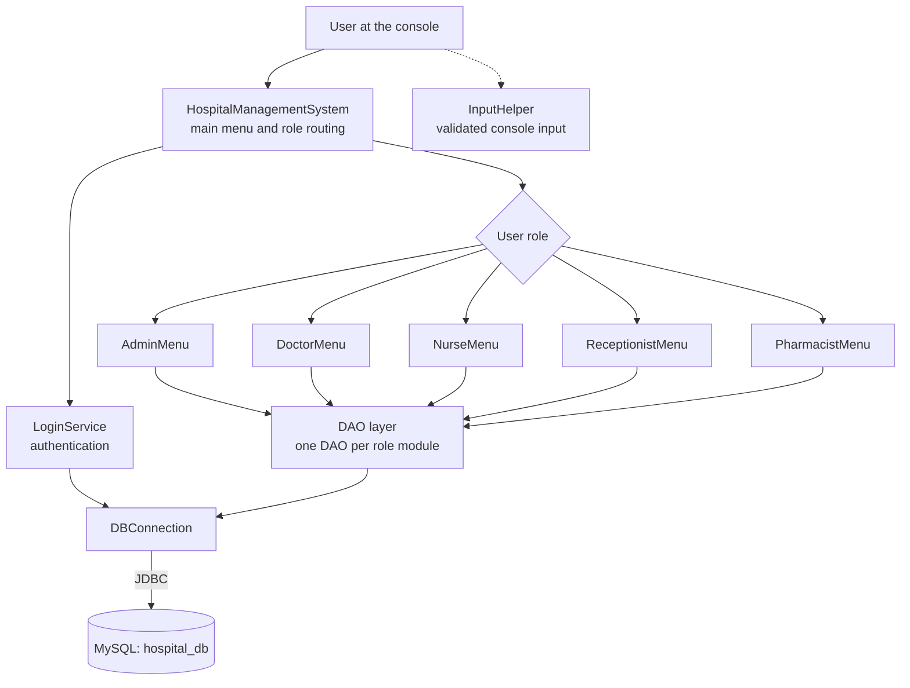
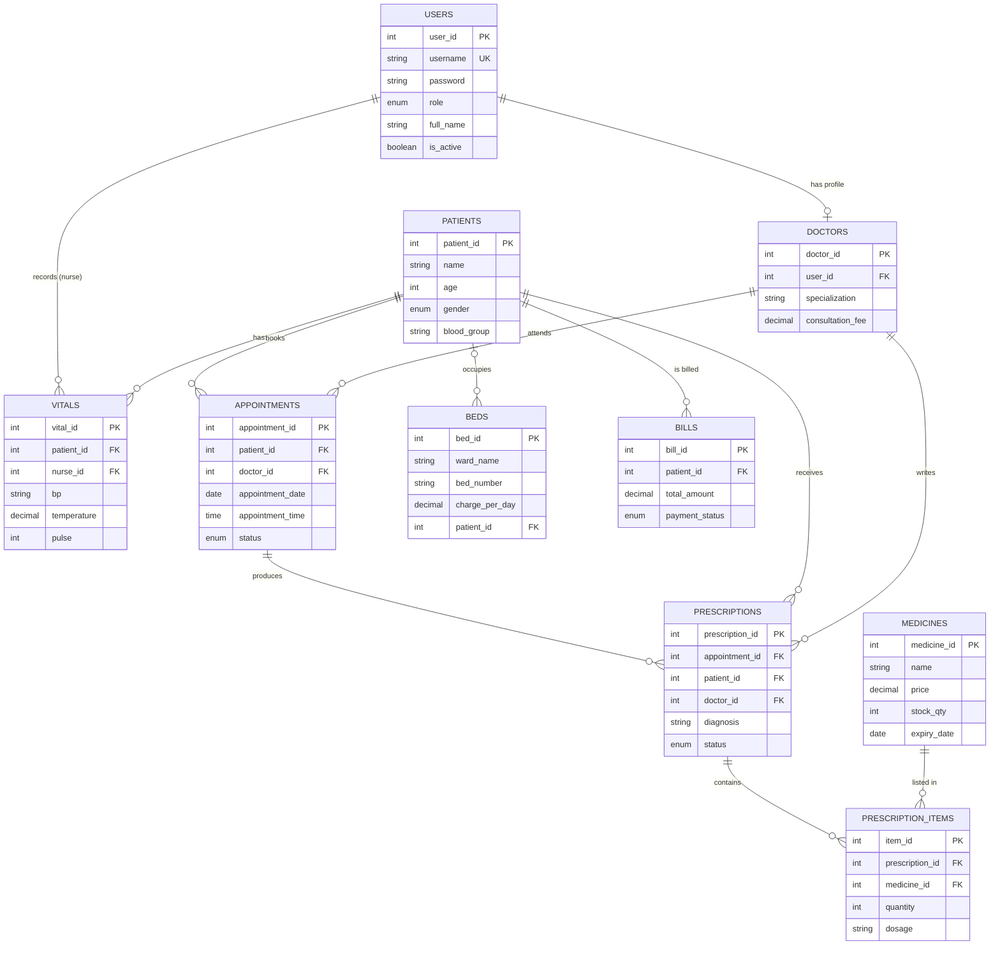
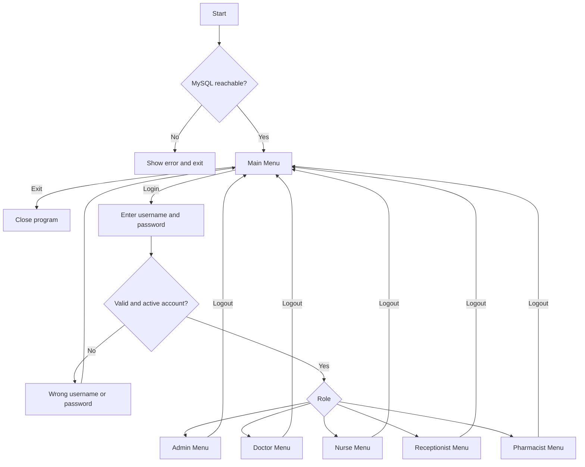
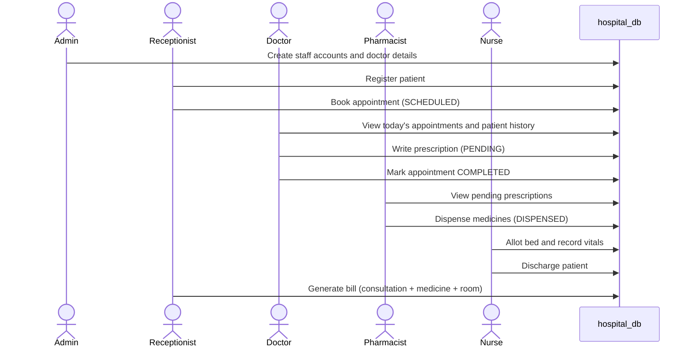

<h1 align="center">🏥 Hospital Management System</h1>

<p align="center">
A centralized, role-based application that digitizes hospital operations: patient records, appointments, prescriptions, pharmacy, bed allocation, vitals monitoring and billing, all backed by a single relational database.
</p>

<p align="center">
  
  
  
  
  
  
  
</p>

---

## 📑 Table of Contents

1. [Project Overview](#1-project-overview)
2. [User Roles and Functionalities](#2-user-roles-and-functionalities)
3. [Modules](#3-modules)
4. [Technology Stack](#4-technology-stack)
5. [System Architecture](#5-system-architecture)
6. [Java Package Structure and Class Descriptions](#6-java-package-structure-and-class-descriptions)
7. [Folder Structure](#7-folder-structure)
8. [Database Design](#8-database-design)
9. [Installation and Setup](#9-installation-and-setup)
10. [Database and JDBC Configuration](#10-database-and-jdbc-configuration)
11. [Running the Application and Logging In](#11-running-the-application-and-logging-in)
12. [Application Workflows](#12-application-workflows)
13. [Screenshots](#13-screenshots)
14. [Troubleshooting](#14-troubleshooting)
15. [Future Enhancements](#15-future-enhancements)
16. [Contributors](#16-contributors)


---

## 1. Project Overview

Hospitals depend on many people working on the same patient record at the right moment: a receptionist registers the patient, a doctor diagnoses, a pharmacist dispenses, a nurse monitors, and the billing desk settles the account. When each group keeps its own paper register or spreadsheet, information is duplicated, lost or out of date.

The **Hospital Management System (HMS)** replaces that fragmentation with one centralized application and one shared database. It is designed to:

- **Digitize hospital operations**: patients, appointments, prescriptions, medicines, beds, vitals and bills are all stored as structured records.
- **Simplify administrative tasks**: staff accounts are managed in one place and every user sees only the functions for their role.
- **Improve patient management**: a patient is registered once and referenced everywhere (appointments, prescriptions, beds, vitals, bills).
- **Maintain organized medical records**: diagnoses, prescriptions, vitals history and billing history stay linked to the patient.

The application runs as a Java console program that connects to a MySQL database through JDBC. After login, each user is routed to a dedicated menu for their role.

---

## 2. User Roles and Functionalities

HMS has five roles. The role is stored in `users.role` and decides which menu opens after login.

| Role | Responsibility |
|---|---|
| 👑 **Admin** | Manages staff accounts and doctor profiles, and oversees the hospital |
| 🩺 **Doctor** | Treats patients, records diagnoses and writes prescriptions |
| 🧑‍⚕️ **Nurse** | Allots beds, discharges patients and records vitals |
| 🧾 **Receptionist** | Registers patients, books appointments and generates bills |
| 💊 **Pharmacist** | Manages medicine stock and dispenses prescriptions |

### 👑 Admin

| Menu option | Description |
|---|---|
| Add Staff Account | Create a login for a doctor, nurse, receptionist, pharmacist or another admin |
| View All Staff | List every user account with role and status |
| Deactivate Staff Account | Disable an account (`is_active = FALSE`); deactivated users cannot log in |
| Add Doctor Details | Attach specialization and consultation fee to a doctor account |
| View All Doctors | List doctors with specialization and fee |
| View Hospital Summary | Overview of hospital activity |

### 🩺 Doctor

| Menu option | Description |
|---|---|
| View Today's Appointments | Appointments scheduled for the doctor today |
| View Patient History | Past visits, diagnoses and prescriptions of a patient |
| Write Prescription | Record diagnosis, notes and the medicines (quantity and dosage) for an appointment |
| Mark Appointment Completed | Change the appointment status to `COMPLETED` |

### 🧑‍⚕️ Nurse

| Menu option | Description |
|---|---|
| View Available Beds | Beds that are free, by ward |
| Allot Bed to Patient | Assign a free bed to a patient and record the admission date |
| Discharge Patient | Release the bed |
| Record Patient Vitals | Save blood pressure, temperature and pulse |
| View Patient Vitals | Show a patient's recorded vitals |

### 🧾 Receptionist

| Menu option | Description |
|---|---|
| Register New Patient | Create a patient record |
| View All Patients | List registered patients |
| Search Patient | Find a patient |
| Book Appointment | Schedule a patient with a doctor for a date and time |
| Cancel Appointment | Set the appointment status to `CANCELLED` |
| Generate Bill | Create a bill from consultation, medicine and room charges, with a payment status |

### 💊 Pharmacist

| Menu option | Description |
|---|---|
| View Pending Prescriptions | Prescriptions with status `PENDING` |
| Dispense Medicines | Fulfil a prescription and mark it `DISPENSED` |
| Add New Medicine | Add a medicine with manufacturer, price, stock and expiry date |
| Update Medicine Stock | Adjust stock quantity |
| View All Medicines | Full medicine inventory |
| View Low Stock / Expiring Medicines | Items that need re-ordering or removal |

> **Patients** are stored as records (`patients` table) that staff manage. Patients do not log in; there is no Patient role in the `users.role` column.

---

## 3. Modules

| # | Module | Purpose | Main tables | Primary roles |
|---|---|---|---|---|
| 1 | **Patient Management** | Register, list and search patients | `patients` | Receptionist, Doctor |
| 2 | **Doctor Management** | Doctor profiles, specialization and fees | `users`, `doctors` | Admin |
| 3 | **Appointment Management** | Book, cancel and complete appointments | `appointments` | Receptionist, Doctor |
| 4 | **Prescription Management** | Diagnosis, prescribed medicines, dispensing | `prescriptions`, `prescription_items` | Doctor, Pharmacist |
| 5 | **Pharmacy / Medicine Inventory** | Stock, prices, expiry tracking | `medicines` | Pharmacist |
| 6 | **Bed and Room Management** | Wards, beds, occupancy and daily charges | `beds` | Nurse |
| 7 | **Vitals Monitoring** | BP, temperature and pulse history | `vitals` | Nurse |
| 8 | **Billing and Payment Management** | Itemized bills and paid/unpaid status | `bills` | Receptionist |
| 9 | **Authentication and Authorization** | Login and role-based menu routing | `users` | All |
| 10 | **Role-Based Dashboards** | A dedicated menu per role | – | All |
| 11 | **Database Management** | Schema, constraints, sample data, app DB user | all | – |

### 3.1 Patient Management
Each patient has a name, age, gender (`MALE`, `FEMALE`, `OTHER`), phone, address, blood group and registration date. The receptionist registers and searches patients. The patient's `patient_id` is the key used by appointments, prescriptions, beds, vitals and bills, so a record is entered once and reused everywhere.

### 3.2 Doctor Management
A doctor is a user (`role = DOCTOR`) plus a row in `doctors` that stores the **specialization** (e.g. Cardiologist, General Physician) and the **consultation fee** (default 500.00). The admin creates the account and then adds the doctor details. Deleting the user cascades to the doctor row.

### 3.3 Appointment Management
An appointment links one patient and one doctor with a date, time and reason. Its status moves through `SCHEDULED` → `COMPLETED` or `CANCELLED`. Receptionists book and cancel; doctors view their day and mark visits complete.

### 3.4 Prescription Management
A prescription belongs to an appointment, patient and doctor and holds a diagnosis and notes. Its medicines are rows in `prescription_items` (medicine, quantity, dosage such as `1-0-1 after food`). A new prescription is `PENDING`; once the pharmacist dispenses it, it becomes `DISPENSED`.

### 3.5 Bed and Room Management
Beds are grouped by ward (General, ICU, Private) and have a bed number that is unique within the ward, a `charge_per_day`, an occupancy flag, the current patient and the admission date. Nurses allot beds to patients and discharge them. The daily charge feeds into the room charge on the bill.

### 3.6 Vitals Monitoring
Nurses record blood pressure (e.g. `120/80`), temperature (°F) and pulse. Each entry stores the patient, the nurse (their user id) and a timestamp, giving a history per patient.

### 3.7 Billing and Payment Management
A bill stores `consultation_charge`, `medicine_charge`, `room_charge`, `total_amount`, the bill date and a `payment_status` (`PAID` or `UNPAID`, default `UNPAID`).

### 3.8 Authentication and Authorization
- **Authentication:** the login screen asks for a username and password. `LoginService` checks them against `users` with a parameterised `PreparedStatement`, accepting only active accounts (`is_active = TRUE`).
- **Authorization:** the returned `User` carries a role. The main class dispatches on it to open only that role's menu, so a nurse never sees receptionist functions.

### 3.9 Role-Based Dashboards
Each role has its own menu class in its own package. Menus loop until the user chooses **Logout**, which returns to the main menu.

### 3.10 Database Management
`database/schema.sql` creates the database, all tables, constraints, sample data and a dedicated application account (`hms_user`) so that the same configuration works on every developer machine.

---

## 4. Technology Stack

| Category | Technology |
|---|---|
| Language | Java 17 (`maven.compiler.release` = 17) |
| Build tool | Apache Maven |
| Database | MySQL 8.0.13 or later |
| Connectivity | JDBC with `mysql-connector-j` 9.7.0 |
| User interface | Console (`Scanner`) |
| IDE | Apache NetBeans |
| Version control | Git |

---

## 5. System Architecture



**Layers**

| Layer | Responsibility | Classes |
|---|---|---|
| Presentation | Menus, prompts and printed output | `*Menu` classes, `InputHelper` |
| Application | Start-up, login, role routing | `HospitalManagementSystem`, `LoginService` |
| Data access (DAO) | SQL for each module, kept out of the menus | `AdminDAO`, `DoctorDAO`, `NurseDAO`, `ReceptionistDAO`, `PharmacistDAO` |
| Model | Data carried between layers | `User` |
| Connectivity | One place to obtain a JDBC connection | `DBConnection` |
| Persistence | Tables and constraints | MySQL `hospital_db` |

### DAO architecture
Menus never contain SQL. A menu reads input through `InputHelper`, calls a method on its role's DAO, and prints the result. Each DAO gets a connection from `DBConnection.getConnection()` inside try-with-resources and uses `PreparedStatement` for every query, which prevents SQL injection and releases connections automatically.

```java
try (Connection con = DBConnection.getConnection();
     PreparedStatement ps = con.prepareStatement(sql)) {
    ps.setString(1, value);
    try (ResultSet rs = ps.executeQuery()) {
        // read rows
    }
}
```

### JDBC database connectivity
`DBConnection` holds the URL, user and password and exposes `getConnection()` and `testConnection()`. The application calls `testConnection()` at start-up and stops with a clear message if MySQL is unreachable.

---

## 6. Java Package Structure and Class Descriptions

Base package: `com.hospital`

| Package | Class | Description |
|---|---|---|
| `com.hospital` | `HospitalManagementSystem` | Entry point. Checks the database connection, shows the main menu (Login / Exit), authenticates the user and opens the menu for the user's role |
| `com.hospital.db` | `DBConnection` | Supplies JDBC connections to `hospital_db`; includes a start-up connectivity test |
| `com.hospital.login` | `LoginService` | Validates username and password against `users` (active accounts only) and returns a `User` or `null` |
| `com.hospital.model` | `User` | The logged-in user: `userId`, `username`, `role`, `fullName` (the password is never stored in this object) |
| `com.hospital.util` | `InputHelper` | `readString`, `readInt`, `readDouble`, `printHeader`; re-prompts on empty or invalid input so wrong input never crashes the program |
| `com.hospital.admin` | `AdminMenu` (+ `AdminDAO`) | Admin dashboard and its data access |
| `com.hospital.doctor` | `DoctorMenu` (+ `DoctorDAO`) | Doctor dashboard and its data access |
| `com.hospital.nurse` | `NurseMenu` (+ `NurseDAO`) | Nurse dashboard and its data access |
| `com.hospital.receptionist` | `ReceptionistMenu` (+ `ReceptionistDAO`) | Receptionist dashboard and its data access |
| `com.hospital.pharmacist` | `PharmacistMenu` (+ `PharmacistDAO`) | Pharmacist dashboard and its data access |

Naming conventions: one package per role; `XxxMenu` for the user interface, `XxxDAO` for SQL; each menu exposes `public static void show(User user)`.

---

## 7. Folder Structure

```text
Hospital-Management-System/
├── README.md
├── .gitignore
├── database/
│   └── schema.sql                      # Database, tables, sample data, app user
└── HospitalManagementSystem/           # Maven project (open this folder in NetBeans)
    ├── pom.xml
    └── src/main/java/com/hospital/
        ├── HospitalManagementSystem.java
        ├── admin/          # AdminMenu (+ AdminDAO)
        ├── db/             # DBConnection
        ├── doctor/         # DoctorMenu (+ DoctorDAO)
        ├── login/          # LoginService
        ├── model/          # User
        ├── nurse/          # NurseMenu (+ NurseDAO)
        ├── pharmacist/     # PharmacistMenu (+ PharmacistDAO)
        ├── receptionist/   # ReceptionistMenu (+ ReceptionistDAO)
        └── util/           # InputHelper
```

---

## 8. Database Design

Database: **`hospital_db`** · Script: `database/schema.sql` · **10 tables**.

### 8.1 Tables

| Table | Purpose |
|---|---|
| `users` | Login accounts for every role |
| `doctors` | Specialization and fee of doctor users |
| `patients` | Patient records |
| `appointments` | Patient–doctor appointments |
| `medicines` | Pharmacy inventory |
| `prescriptions` | Prescription headers |
| `prescription_items` | Medicines within a prescription |
| `beds` | Beds, occupancy and charges |
| `vitals` | Recorded vital signs |
| `bills` | Patient bills |

### 8.2 Columns, keys and constraints

**`users`**: PK `user_id` · `username` (UNIQUE, NOT NULL) · `password` · `role` ENUM(`ADMIN`,`DOCTOR`,`NURSE`,`RECEPTIONIST`,`PHARMACIST`) · `full_name` · `phone` · `is_active` (default TRUE) · `created_at`

**`doctors`**: PK `doctor_id` · `user_id` (UNIQUE, FK → `users.user_id`, ON DELETE CASCADE) · `specialization` · `consultation_fee` DECIMAL(10,2) default 500.00

**`patients`**: PK `patient_id` · `name` · `age` · `gender` ENUM(`MALE`,`FEMALE`,`OTHER`) · `phone` · `address` · `blood_group` · `registered_on` (default current date)

**`appointments`**: PK `appointment_id` · FK `patient_id` → `patients` · FK `doctor_id` → `doctors` · `appointment_date` · `appointment_time` · `reason` · `status` ENUM(`SCHEDULED`,`COMPLETED`,`CANCELLED`) default `SCHEDULED`

**`medicines`**: PK `medicine_id` · `name` · `manufacturer` · `price` · `stock_qty` (default 0) · `expiry_date`

**`prescriptions`**: PK `prescription_id` · FK `appointment_id` → `appointments` · FK `patient_id` → `patients` · FK `doctor_id` → `doctors` · `diagnosis` · `notes` · `created_on` · `status` ENUM(`PENDING`,`DISPENSED`) default `PENDING`

**`prescription_items`**: PK `item_id` · FK `prescription_id` → `prescriptions` (ON DELETE CASCADE) · FK `medicine_id` → `medicines` · `quantity` · `dosage`

**`beds`**: PK `bed_id` · `ward_name` · `bed_number` · UNIQUE(`ward_name`,`bed_number`) · `charge_per_day` · `is_occupied` (default FALSE) · FK `patient_id` → `patients` (nullable) · `admitted_on` (nullable)

**`vitals`**: PK `vital_id` · FK `patient_id` → `patients` · FK `nurse_id` → `users.user_id` · `bp` · `temperature` DECIMAL(4,1) (°F) · `pulse` · `recorded_at`

**`bills`**: PK `bill_id` · FK `patient_id` → `patients` · `consultation_charge` · `medicine_charge` · `room_charge` · `total_amount` · `bill_date` · `payment_status` ENUM(`PAID`,`UNPAID`) default `UNPAID`

### 8.3 ER diagram



### 8.4 Relationship summary

| Parent | Child | Foreign key | Cardinality |
|---|---|---|---|
| `users` | `doctors` | `doctors.user_id` | 1 : 0..1 (cascade delete) |
| `users` | `vitals` | `vitals.nurse_id` | 1 : many |
| `patients` | `appointments` | `appointments.patient_id` | 1 : many |
| `doctors` | `appointments` | `appointments.doctor_id` | 1 : many |
| `appointments` | `prescriptions` | `prescriptions.appointment_id` | 1 : many |
| `patients` | `prescriptions` | `prescriptions.patient_id` | 1 : many |
| `doctors` | `prescriptions` | `prescriptions.doctor_id` | 1 : many |
| `prescriptions` | `prescription_items` | `prescription_items.prescription_id` | 1 : many (cascade delete) |
| `medicines` | `prescription_items` | `prescription_items.medicine_id` | 1 : many |
| `patients` | `vitals` | `vitals.patient_id` | 1 : many |
| `patients` | `beds` | `beds.patient_id` | 1 : 0..1 current occupant |
| `patients` | `bills` | `bills.patient_id` | 1 : many |

### 8.5 Sample data

`schema.sql` inserts 6 users, 2 doctors, 3 patients, 3 appointments, 4 medicines, 1 prescription with 1 item and 6 beds (3 General, 2 ICU, 1 Private), so every role has something to work with immediately.

---

## 9. Installation and Setup

### 9.1 Prerequisites

| Requirement | Version | Notes |
|---|---|---|
| JDK | 17 or newer | Required by `maven.compiler.release` = 17 |
| Apache NetBeans | Recent release with Maven support | Bundles Maven |
| MySQL Server | 8.0.13 or newer | `schema.sql` uses expression defaults such as `DEFAULT (CURRENT_DATE)` |
| MySQL Workbench | Optional | Or use the `mysql` command-line client |
| Internet | First build only | Maven downloads `mysql-connector-j` |

### 9.2 Install Java
1. Download and install a JDK 17 or newer (Temurin, Oracle JDK or OpenJDK).
2. Verify in a terminal: `java -version` (should report 17 or higher) and `javac -version`.

### 9.3 Install NetBeans
1. Download Apache NetBeans from netbeans.apache.org and install it.
2. Start NetBeans and check *Tools → Java Platforms* lists JDK 17+.

### 9.4 Get the project
```bash
git clone <your-repository-url>
cd Hospital-Management-System
```
Or extract the project ZIP. You should see `database/` and `HospitalManagementSystem/`.

### 9.5 Import into NetBeans
1. **File → Open Project…**
2. Select the **inner** `HospitalManagementSystem` folder (the one with `pom.xml`).
3. Click **Open Project** and wait for Maven to download dependencies.
4. Under **Dependencies**, confirm `mysql-connector-j-9.7.0.jar` is present. If not, right-click the project → **Reload POM**, then **Clean and Build**.

---

## 10. Database and JDBC Configuration

### 10.1 Create the database
> ⚠️ `schema.sql` begins with `DROP DATABASE IF EXISTS hospital_db;`. Running it again **erases and recreates** the database.

Run the script once as a MySQL administrator (normally `root`).

**MySQL Workbench:** connect as `root` → *File → Open SQL Script…* → choose `database/schema.sql` → click **Execute**. The last result shows `Database ready!`.

**Command line:**
```bash
mysql -u root -p < database/schema.sql
```

### 10.2 Application database user
The script ends by creating a dedicated account used by the Java code:

```sql
CREATE USER 'hms_user'@'localhost' IDENTIFIED BY 'hms123';
GRANT ALL PRIVILEGES ON hospital_db.* TO 'hms_user'@'localhost';
FLUSH PRIVILEGES;
```

### 10.3 Configure JDBC credentials
Connection settings are in `src/main/java/com/hospital/db/DBConnection.java`:

```java
private static final String URL      = "jdbc:mysql://localhost:3306/hospital_db";
private static final String USER     = "hms_user";
private static final String PASSWORD = "hms123";
```

- Different host or port? Edit `URL`.
- Different password? Change it in **both** the `CREATE USER` line of `schema.sql` and `PASSWORD` in `DBConnection.java`.

The JDBC driver comes from the Maven dependency:

```xml
<dependency>
    <groupId>com.mysql</groupId>
    <artifactId>mysql-connector-j</artifactId>
    <version>9.7.0</version>
</dependency>
```

### 10.4 Verify
```sql
USE hospital_db;
SHOW TABLES;                       -- 10 tables
SELECT username, role FROM users;  -- 6 accounts
```
```bash
mysql -u hms_user -phms123 hospital_db -e "SELECT COUNT(*) FROM users;"
```
When the application starts it tests the connection itself: the main menu appears on success; otherwise it prints `Could not connect to MySQL.` and exits.

---

## 11. Running the Application and Logging In

### 11.1 Run in NetBeans
1. Make sure MySQL is running and `schema.sql` has been executed.
2. Right-click the **HospitalManagementSystem** project → **Run** (the main class is `com.hospital.HospitalManagementSystem`). Alternatively open that file and press **Shift+F6** (Run File).
3. Click inside the **Output** window and type your answers there, pressing Enter after each.

### 11.2 Run from a terminal
From the folder containing `pom.xml`:
```bash
mvn compile exec:java
```
(`exec.mainClass` is already configured in `pom.xml`.)

### 11.3 Log in with each role

| Role | Username | Password | Menu opened |
|---|---|---|---|
| Admin | `admin` | `admin123` | Admin Menu |
| Doctor | `drsharma` | `doc123` | Doctor Menu |
| Doctor | `drmehta` | `doc123` | Doctor Menu |
| Nurse | `nurse1` | `nurse123` | Nurse Menu |
| Receptionist | `reception` | `rec123` | Receptionist Menu |
| Pharmacist | `pharma` | `pharma123` | Pharmacist Menu |

Choose `1. Login` on the main menu, enter the credentials, use the role menu, and select **Logout** to return to the main menu. Choose `2. Exit` to close the program.

```text
==========================================
      HOSPITAL MANAGEMENT SYSTEM
==========================================

========== MAIN MENU ==========
1. Login
2. Exit
Enter choice: 1

========== LOGIN ==========
Username: reception
Password: rec123
Welcome, Rohit Kumar!

========== RECEPTIONIST MENU ==========
1. Register New Patient
2. View All Patients
...
```

> These are demonstration credentials for local use. Change them before any real deployment.

---

## 12. Application Workflows

### 12.1 Login and role routing



### 12.2 Patient journey across roles



| Step | Role | Action | Tables touched |
|---|---|---|---|
| 1 | Admin | Create staff accounts, add doctor details | `users`, `doctors` |
| 2 | Receptionist | Register patient, book appointment | `patients`, `appointments` |
| 3 | Doctor | Review appointment, write prescription, complete visit | `appointments`, `prescriptions`, `prescription_items` |
| 4 | Pharmacist | Dispense prescription, manage stock | `prescriptions`, `medicines` |
| 5 | Nurse | Record vitals, allot and discharge beds | `vitals`, `beds` |
| 6 | Receptionist | Generate bill | `bills` |

---

## 13. Screenshots

Place images in `docs/screenshots/` and update the paths.

| Screen | Placeholder |
|---|---|
| Start-up banner and main menu | `` |
| Login | `` |
| Admin menu | `` |
| Doctor menu | `` |
| Nurse menu | `` |
| Receptionist menu | `` |
| Pharmacist menu | `` |
| Patient registration | `` |
| Appointment booking | `` |
| Prescription | `` |
| Bed allotment | `` |
| Vitals | `` |
| Bill | `` |
| MySQL tables | `` |

---

## 14. Troubleshooting

### Database and JDBC

| Symptom | Cause | Fix |
|---|---|---|
| `Communications link failure`, then `Could not connect to MySQL.` | MySQL is stopped or on another port | Start MySQL; confirm port 3306 or edit `URL` in `DBConnection.java` |
| `Access denied for user 'hms_user'@'localhost'` | `schema.sql` not run, or password mismatch | Run the script as `root`; keep the password identical in the script and `DBConnection.java` |
| `Unknown database 'hospital_db'` | Script not run or failed part-way | Re-run `schema.sql` and read any errors |
| `No suitable driver` / `ClassNotFoundException: com.mysql.cj.jdbc.Driver` | Connector JAR not on classpath | Open the inner folder as a Maven project → **Reload POM** → **Clean and Build** |
| `Public Key Retrieval is not allowed` | Authentication setting on some MySQL installs | For local development, append `?allowPublicKeyRetrieval=true&useSSL=false` to `URL` |
| SQL syntax error near `(CURRENT_DATE)` | MySQL older than 8.0.13 | Upgrade MySQL |
| `Access denied; you need the CREATE USER privilege` | Script run by a non-admin account | Run as `root` |

### Java, Maven and NetBeans

| Symptom | Cause | Fix |
|---|---|---|
| `release version 17 not supported` | Older JDK in use | Install JDK 17+; set it in *Tools → Java Platforms* and the NetBeans Maven settings, or set `JAVA_HOME` |
| Red errors on `com.mysql` imports | Dependencies not resolved | Wait for indexing; **Reload POM**; check internet |
| `Could not transfer artifact ... from/to central` | No access to Maven Central | Check network or proxy under *Tools → Options → Java → Maven* |
| No main class / Run does nothing | Outer folder opened | Open the inner `HospitalManagementSystem` folder, or right-click `HospitalManagementSystem.java` → **Run File** |
| Cannot type input | Output window not focused | Click inside the **Output** panel |
| `Wrong username or password!` | Typo, or the account is inactive | `SELECT username, password, is_active FROM users;` |

**Checklist:** MySQL running → `schema.sql` executed without errors → `mysql -u hms_user -phms123 hospital_db` works → inner Maven folder open → connector JAR under Dependencies → JDK 17+.

---

## 15. Future Enhancements

- Hash passwords (for example with BCrypt) instead of storing plain text.
- Move database credentials to a properties file or environment variables.
- Prevent double-booking of a doctor at the same date and time.
- Departments, working schedules and patient check-in tracking.
- A patient self-service portal (view appointments, prescriptions and bills).
- Reports: daily appointments, low stock, bed occupancy, revenue.
- Use Java `enum`s for roles and statuses.
- Automated tests (JUnit) and a graphical or web front end.
- Audit logging of staff actions.

---

## 16. Contributors

| Name | Module / Contribution | GitHub |
|---|---|---|
| Shakshi Wadhwa |_Admin module_, _Doctor module_ | [@shakshiwadhwa7-rgb](https://github.com/shakshiwadhwa7-rgb) |
| rishikapopli|_Receptionist module_ | [@rishikapopli](https://github.com/rishikapopli) |
| Udayveer Singh Salaria | _Nurse module_ | _link_ |
| Saksham Tayal | _Pharmacist module_ | _link_ |


---


